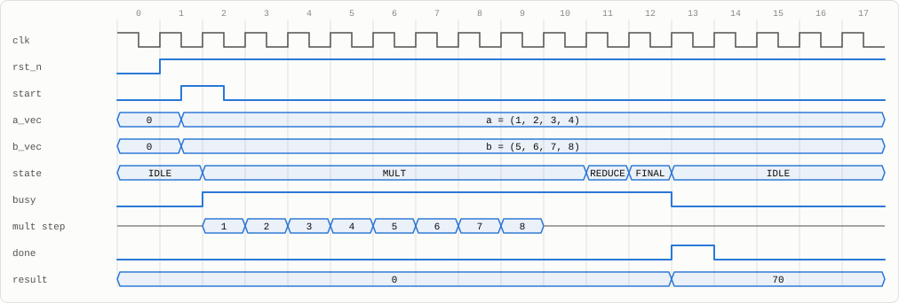
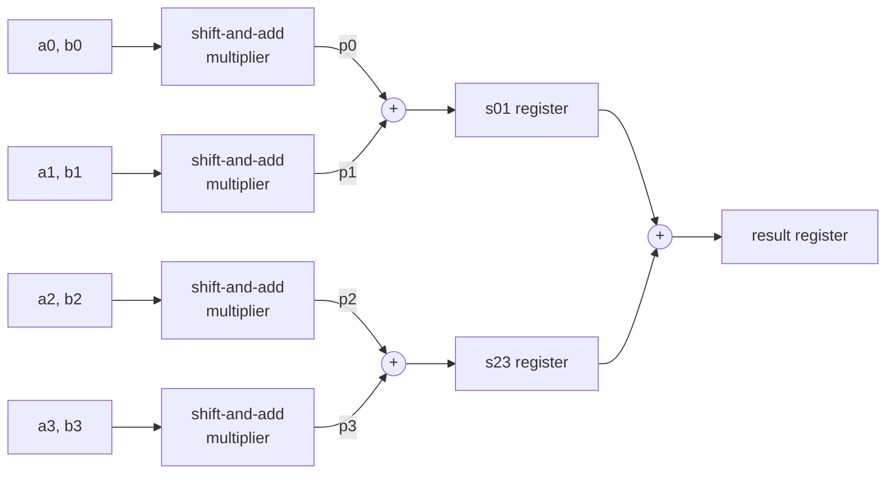
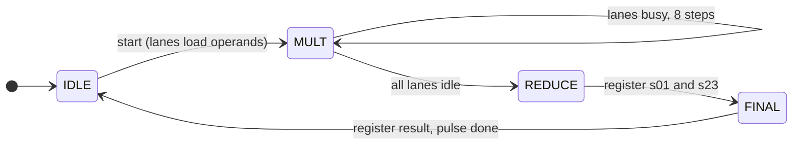

# Four-Lane Dot-Product Engine

[](https://github.com/Divabhattacharya/four-lane-dot-product-engine/actions/workflows/tests.yml)


A 4-lane, 8-bit dot-product unit in synthesizable Verilog. It contains **no `*`
operator**: every multiply is a sequential shift-and-add unit, and every add is a
ripple-carry adder built from full-adder cells. The control FSM drives a
start/done handshake and produces a registered result. The design is checked by
self-checking testbenches, including an exhaustive test of the multiplier.

<p align="center">
  <picture>
    <source media="(prefers-color-scheme: dark)" srcset="docs/waveform-dark.svg">
    
  </picture>
  <br>
  <sub>One transaction, captured from simulation: (1, 2, 3, 4) · (5, 6, 7, 8) = 70.
  The engine accepts <code>start</code> in IDLE, and each lane multiplier runs 8 add-and-shift steps.
  The adder tree then takes two cycles, and <code>done</code> pulses with the registered result.</sub>
</p>

## At a glance

| | |
|---|---|
| **Operation** | `a0·b0 + a1·b1 + a2·b2 + a3·b3`, unsigned |
| **Widths** | 4 × 8-bit operands per vector → 18-bit result (max 260,100) |
| **Latency** | 11 cycles from `start` to `done` |
| **Throughput** | one result every 12 cycles back-to-back (next `start` in the `done` cycle) |
| **Multipliers** | 4 parallel shift-and-add units, no `*` (enforced by `make synth`) |
| **Adder tree** | 2 levels of ripple-carry adders with a pipeline register between levels |
| **Interface** | `start` / `busy` / `done` handshake, registered `result`, async active-low reset |
| **Synthesis** | Yosys generic: 167 flip-flops, 0 multiplier cells |
| **Verification** | 65,536 / 65,536 products (exhaustive) · 5,247 engine transactions · **0 errors** |

## Architecture



The control FSM sequences the datapath:



- `start` is sampled only in IDLE, so it is ignored while the engine is busy.
  Operands are captured in the cycle `start` is accepted.
- `done` is a registered one-cycle pulse. `result` is registered and held until
  the next transaction completes.
- Reset is asynchronous and active-low. It clears the FSM, the pipeline
  registers, `result`, `done` and all multiplier state.

## How the multiplier works

Each lane is a right-shift multiplier with three registers: `M` (the
multiplicand), `A` (the upper half of the product) and `Q` (the lower half,
which starts out holding the multiplier). A counter runs it for 8 cycles. In
each cycle, if `Q[0]` is 1, the ripple-carry adder computes `A + M`. Then
`{carry, A, Q}` shifts right by one bit. After 8 cycles the 16-bit product is
`{A, Q}`.

Worked example from simulation, 13 × 11 (`M = 00001101`):

| Step | Q[0] | Operation | A | Q |
|:---:|:---:|---|---|---|
| load | – | A ← 0, Q ← 11 | `00000000` | `00001011` |
| 1 | 1 | A + M, shift | `00000110` | `10000101` |
| 2 | 1 | A + M, shift | `00001001` | `11000010` |
| 3 | 0 | shift | `00000100` | `11100001` |
| 4 | 1 | A + M, shift | `00001000` | `11110000` |
| 5 | 0 | shift | `00000100` | `01111000` |
| 6 | 0 | shift | `00000010` | `00111100` |
| 7 | 0 | shift | `00000001` | `00011110` |
| 8 | 0 | shift | `00000000` | `10001111` |

The result is `{A, Q} = 0000000010001111 = 143`.

## Verification

Every transaction is compared against a behavioral reference model. The model
is allowed to use `*`; the RTL is not.

| Test | What it checks | Count |
|---|---|---:|
| Exhaustive multiplier | every 8-bit × 8-bit pair; 8-cycle latency; one-cycle `done`; product held afterwards; random `start` and operand noise while busy is ignored | 65,536 |
| Reset values | `result`, `busy` and `done` are cleared | – |
| Corner cases | all-zero, all-max (largest result), max × 0, single active lanes, mismatched lanes, carry into bit 16, alternating bit patterns, powers of two | 24 |
| Random | random operands; one in four also gets `start` and operand noise while busy | 5,000 |
| Repeated | the same operands run again and again | 10 |
| Back-to-back | next `start` issued in the same cycle as `done` | 200 |
| In-flight reset | async reset at each of the 13 points in a transaction; then no stale `done`/`busy`, and the next transaction is correct | 13 |

```
shift_add_mult exhaustive test: 65536 products checked, 0 errors
ALL TESTS PASSED
dot_product_engine: 5247 transactions, 13 in-flight resets, 0 errors
latency start->done = 11 cycles
ALL TESTS PASSED
synthesis OK: no multiplier cells inferred
```

### The testbenches catch real bugs

A test that passes only means something if it can fail. Each of these bugs was
injected into the RTL on its own, and every one was caught:

| Injected bug | Caught by | Errors reported |
|---|---|---:|
| Wrong full-adder carry | multiplier testbench | 103,560 |
| Off-by-one iteration count | multiplier testbench | 195,840 |
| Multiplier accepts `start` while busy | multiplier testbench | 327,670 |
| Adder-tree carry dropped | engine testbench | 721 |
| Engine accepts `start` while busy | engine testbench | 4,668 |
| `done` held high instead of pulsed | engine testbench | 25,593 |
| `result` not cleared by reset | engine testbench | 14 |
| A `*` added to the RTL | `make synth` | build fails |

## Run it

Requires Icarus Verilog and Yosys. Tested with Icarus Verilog 13.0 / Yosys 0.70
locally and Icarus Verilog 12.0 / Yosys 0.33 in GitHub Actions, which re-runs
all tests and synthesis on every push.

```bash
make test     # both self-checking testbenches
make synth    # Yosys: fail if any $mul cell exists, then synthesize and print cell stats
make wave     # rebuild the engine testbench with a VCD dump for GTKWave
```

## Repository layout

```
rtl/
  full_adder.v            1-bit full adder cell
  ripple_carry_adder.v    parameterized W-bit adder generated from full adders
  shift_add_mult.v        sequential shift-and-add multiplier
  dot_product_engine.v    4 lanes + pipelined adder tree + control FSM
tb/
  tb_shift_add_mult.v     exhaustive multiplier testbench
  tb_dot_product_engine.v engine testbench with behavioral reference model
docs/                     waveform figures
Makefile
```
